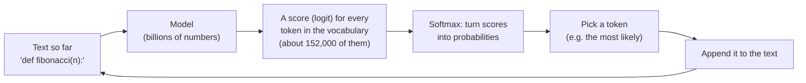
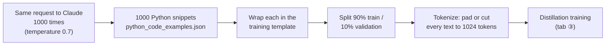
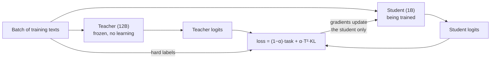
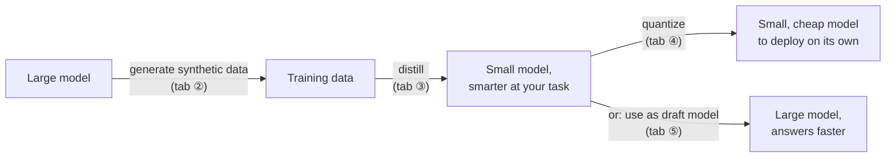
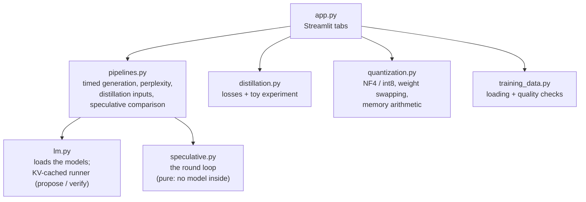

# How Small Language Models Work: a Beginner's Guide

This guide explains the **Small Language Model** pattern from the ground up and walks through every
part of the Small Language Model Explorer app. No machine-learning background is needed. If a word
is unfamiliar, check the [glossary](../GLOSSARY.md).

> **The 30-second version.** Big language models are smart but slow and expensive, because every
> word they write needs a pass through billions of numbers. A **small language model** has far fewer
> numbers, so it is fast and cheap but less capable. Three tricks close the gap:
>
> 1. **Knowledge distillation:** train the small model to imitate the big one, so it becomes smarter.
> 2. **Quantization:** store each number with fewer bits, so any model becomes smaller.
> 3. **Speculative decoding:** let the small model draft and the big model approve, so the big
>    model writes exactly what it would have written, only faster.
>
> The app has one tab for each of these, plus a tab comparing the two models and one on the
> training data.

**Contents**

1. [What makes a model "large" or "small"](#1-what-makes-a-model-large-or-small)
2. [Small vs large (tab ①)](#2-small-vs-large-tab-)
3. [Training data (tab ②)](#3-training-data-tab-)
4. [Knowledge distillation (tab ③)](#4-knowledge-distillation-tab-)
5. [Quantization (tab ④)](#5-quantization-tab-)
6. [Speculative decoding (tab ⑤)](#6-speculative-decoding-tab-)
7. [How the three techniques fit together](#7-how-the-three-techniques-fit-together)
8. [How the app is built](#8-how-the-app-is-built)
9. [Where the app differs from the example scripts](#9-where-the-app-differs-from-the-example-scripts)
- [Appendix A: the distillation loss by hand](#appendix-a-the-distillation-loss-by-hand)
- [Appendix B: NF4 quantization by hand](#appendix-b-nf4-quantization-by-hand)
- [Appendix C: when does speculative decoding pay off?](#appendix-c-when-does-speculative-decoding-pay-off)

---

## 1. What makes a model "large" or "small"

### A language model writes one token at a time

A language model doesn't write a sentence in one go. It runs a loop:



- A **token** is a chunk of text: often a whole word with its leading space (`␣return`), sometimes
  part of a word, a symbol, or a line break. In the app, `␣` shows a space and `⏎` a line break.
- **Logits** are the model's raw scores, one per token. Higher means "this fits better".
- **Softmax** turns logits into **probabilities** that add up to 100%.
- **Greedy decoding** always picks the most probable token. The app uses greedy decoding almost
  everywhere, so runs are repeatable and any difference you see comes from the technique, not luck.

### Parameters: the numbers inside the model

A model is mostly a huge collection of numbers called **parameters** (or **weights**), learned during
training. To pick each token, the model multiplies the text-so-far through **all** of them.
Two consequences follow, and they explain this whole pattern:

1. **Memory.** Every parameter has to sit in memory. Memory needed = parameters × bytes per parameter.
2. **Speed.** Every token needs (roughly) one full pass over every parameter. More parameters means
   more arithmetic and, above all, more data moved from memory to the processor for each token.

| Model | Parameters | Bytes each (16-bit) | Memory for weights |
|---|---|---|---|
| Qwen2.5-0.5B (app's small model) | 0.49 billion | 2 | ≈ 1 GB |
| Qwen2.5-1.5B (app's large model) | 1.54 billion | 2 | ≈ 3.1 GB |
| Gemma 3 12B (script's teacher) | 12 billion | 2 | ≈ 24 GB |
| Gemma 3 27B (script's speculative target) | 27 billion | 2 | ≈ 54 GB |

A **small language model (SLM)** is simply a model small enough to run cheaply: on a laptop, a phone,
or a modest server, with low latency and without sending data to someone else's cloud. Small models
are often good enough for a narrow job. The example folder's `USAGE.md` cites Amazon using fine-tuned
SLMs to standardise drug names and dosages: a narrow, repetitive task where a big general model is
overkill.

### Which model plays which role

The example scripts use Gemma 3 models that need a large GPU. The app uses two Qwen2.5 models that
run on a laptop CPU. They share the same vocabulary (the same list of tokens), which distillation and
speculative decoding both need.

| Role | In the scripts | In the app |
|---|---|---|
| Small vs large comparison | gemma-3-1b-it vs gemma-3-12b-it | Qwen2.5-0.5B vs Qwen2.5-1.5B |
| **Teacher** (distillation) | gemma-3-12b-it | Qwen2.5-1.5B |
| **Student** (distillation) | gemma-3-1b-it | Qwen2.5-0.5B |
| Model being quantized | gemma-3-1b-it | Qwen2.5-0.5B |
| **Target model** (speculative decoding) | gemma-3-27b-it | Qwen2.5-1.5B |
| **Draft model** (speculative decoding) | gemma-3-4b-it | Qwen2.5-0.5B |

The size *ratios* differ (the scripts' teacher is 12× its student; the app's is 3×), so the effects
in the app are smaller, but the mechanics are identical.

---

## 2. Small vs large (tab ①)

### The idea

Run the same prompt through both models and compare quality, speed and memory. This is what
`model_comparison.py` does, asking each model to write documentation for a Python snippet.

### Two phases: reading the prompt, then writing

Generating text has two very different phases, and the app times them separately:

```
Prompt: 278 tokens                           Reply: up to 128 tokens
┌──────────────────────────────────┐        ┌──┬──┬──┬──┬──┬──┬──┬──┬──
│  read all 278 tokens in one pass │  ───▶  │t1│t2│t3│t4│t5│t6│t7│t8│ …  one pass per token
└──────────────────────────────────┘        └──┴──┴──┴──┴──┴──┴──┴──┴──
   "time to first token"                       "tokens per second"
```

- **Time to first token:** the model reads the whole prompt and picks the first reply token. Longer
  prompts take longer.
- **Tokens per second (throughput):** after that, each new token needs one more pass. The model
  doesn't re-read the whole prompt each time, because it keeps a memory of its work so far called the
  **KV cache** ("key/value cache"). Each step only processes the one new token.

### A real example from the app

With the default prompt (278 tokens) and 16 new tokens, one run on an 8 GB Apple M2 laptop gave:

| | Qwen2.5-0.5B | Qwen2.5-1.5B |
|---|---|---|
| Parameters | 0.49 B | 1.54 B |
| Weights in memory (fp16) | 988 MB | 3.09 GB |
| Time to first token | 2.1 s | 8.3 s |
| Tokens per second | 37.5 | 6.5 |

The small model was about **6× faster** at writing and **4× faster** at reading the prompt, with
about a third of the memory. And the outputs? The 0.5B model started with
`# Task Class Documentation … The Task class is a data class that represents a task with attributes such as id, title, description…`,
while the 1.5B model wrote
`Below is the documentation for the provided Python code snippet: ### Task Class` and then quoted the
code with explanations. Read longer outputs (raise *Max new tokens*) and judge which is more accurate.
That's the trade-off you're buying with speed.

> Timings on a laptop vary a lot from run to run, especially if other apps are using memory.
> Look at the ratios rather than the exact numbers.

### Same text, two opinions

The second half of the tab shows each model's top 10 next tokens for the same text. For
`def fibonacci(n):⏎ if n <= 1:⏎ return`:

| Token | 0.5B | 1.5B |
|---|---|---|
| `␣n` | 92.6% | 98.4% |
| `␣` | 6.9% | 1.3% |
| `(n` | under 0.1% | 0.1% |

Both agree on the answer, but the large model is **more confident**. Whole probability lists like
these are what knowledge distillation (tab ③) trains the small model to copy.

### Things to try

- Paste a harder prompt (a tricky bug to explain, a maths word problem) and compare quality.
- Make the prompt much longer and watch *time to first token* grow while *tokens per second* stays
  about the same.

---

## 3. Training data (tab ②)

### Why distillation needs data

To distill, you run **text** through both the teacher and the student and nudge the student towards
the teacher's predictions. You need text that looks like the job you want the student to do. The
example targets Python code, so `generate_training_set.py` asks a strong model (Claude 3.7 Sonnet)
to write it. This is **synthetic data**: data generated by a model instead of collected from people.

### How the data was made



The request was: *"Generate a non-trivial but not too complex Python code example. Focus on common
programming patterns and best practices. Return only the code…"*. Temperature 0.7 adds some
randomness so the 1000 answers aren't identical.

Each snippet is wrapped in this template before training:

```
Below is a Python code snippet. Please generate comprehensive documentation for it.

Code:
{the snippet}

Documentation:
```

**An important subtlety:** nothing comes after `Documentation:`. The student is *not* shown any
documentation. Training is plain "predict the next token" over the template and the code, so what the
student really learns is *to predict Python code the way the teacher does*. That still transfers a lot
of the teacher's knowledge about code, but it's worth knowing exactly what is being taught.

### Data quality checks (what the tab found)

| Check | Result | What it means |
|---|---|---|
| Examples | 1000 | |
| Unique | 996 | 4 exact duplicates |
| Complete, valid Python | 166 (17%) | 834 snippets stop mid-line: they were cut off |
| Contain `class Task` | 83% | Most snippets are variations of a task manager |
| Length | 366 to 434 tokens per snippet | All far below the 1024-token limit; each text gets 550+ padding tokens |

Two lessons follow:

1. **Asking one model the same question many times gives similar answers.** Most snippets have a
   `Task` class and a `TaskManager`. A student trained on this learns that narrow slice of Python
   very well and the rest barely at all. Real pipelines add variety on purpose: different topics,
   styles, difficulty levels and libraries in the prompt.
2. **Always check generated data.** Most snippets were cut off. A quick automatic check (here, "does
   Python's own parser accept it?") catches this before you spend GPU hours training on it.

### Things to try

- Search for `Inventory` or `async` to find the rarer snippets.
- Browse a few snippets marked ⚠️ and look at the last line to see where each was cut off.

---

## 4. Knowledge distillation (tab ③)

### The idea: learn from the teacher's whole answer, not just the right one

Imagine a student taking a multiple-choice test. A normal answer key says only *"The answer is B."*
A good teacher says *"The answer is B. C was a reasonable guess; A and D make no sense."* The second
version teaches much more per question.

Language models train the same way. At each position in the training text:

- The **hard label** is the token that actually comes next in the training text (not the
  teacher's prediction). Normal training pushes the model to give it 100%.
- The **soft label** is the teacher's whole probability list for that position, including how much
  it likes the *wrong-but-plausible* tokens. That extra information is sometimes called *dark
  knowledge*.

**Knowledge distillation** trains the student on both.

### Temperature: making the small probabilities visible

The teacher is usually very confident, so the soft label is often 99% on one token and tiny numbers
on the rest. Those tiny numbers carry the useful "almost right" information, but they're too small to
matter. The **distillation temperature T** fixes this: divide every logit by T before softmax.
T = 1 changes nothing, and T > 1 flattens the distribution so the small probabilities grow.

Logits `[3, 2, 0.5, −1]` for four tokens:

| | token 1 | token 2 | token 3 | token 4 |
|---|---|---|---|---|
| T = 1 | 68.1% | 25.1% | 5.6% | 1.2% |
| T = 2 | 49.3% | 29.9% | 14.1% | 6.7% |
| T = 4 | 37.3% | 29.0% | 20.0% | 13.7% |

The *order* never changes; only how strongly the top token dominates. (This is not the same as the
sampling temperature used when generating text, although the arithmetic is the same.)

### The loss: what the student is trained to make smaller

The example script (`DistillationTrainer.compute_loss`) uses:

```
loss = (1 − α) × task loss  +  α × distillation loss

task loss         = cross-entropy(student, hard label)
                  = −log( student's probability of the correct token )

distillation loss = T² × KL( teacher at temperature T  ‖  student at temperature T )
```

- **Task loss** is small when the student gives the correct token a high probability. If the
  student gives it 50%, the loss is −log(0.5) = 0.69; at 99% it is 0.01; at 1.7% it is 4.06.
- **KL divergence** measures how different two probability lists are. It is 0 when they are
  identical and grows as they disagree, especially where the teacher puts probability but the student
  doesn't. Appendix A works one out by hand, including a full example that starts from logits.
- **T²**: softening with temperature makes the student's corrections (the gradients) roughly T²
  times weaker. Multiplying by T² puts them back to their normal size, so changing T doesn't
  secretly change how much the distillation term counts.
- **α (alpha)** sets the balance. α = 0 is ordinary training (hard labels only); α = 1 is pure
  imitation of the teacher. The script uses **T = 2, α = 0.5**.

### Part A: the loss on a real training example

Training the 0.5B student for real needs a GPU (see "How the real training run works" below), so
part A does the forward half of one training step: it runs one training text through both models
and calculates every term of the loss at every position. Then the T and α sliders recalculate
instantly.

Real numbers from snippet #0 (first 64 tokens, T = 2, α = 0.5):

| | Value |
|---|---|
| Task loss (average over 63 positions) | 1.753 |
| Distillation loss (average) | 1.878 |
| Student's top token = teacher's top token | 78% of positions |

**Position 1: the student is surprised.** After `Below`, the actual next token is `␣is`:

| Token | teacher T=1 | teacher T=2 (soft label) | student T=1 | student T=2 |
|---|---|---|---|---|
| `␣is` ← hard label | **73.2%** | 6.8% | **1.7%** | 0.2% |
| `␣the` | 8.6% | 2.3% | 1.2% | 0.1% |
| `␣you` | 7.4% | 2.1% | 0.4% | 0.1% |

The teacher has seen enough text starting "Below is…" to expect `␣is`; the student hasn't. Task loss
= −log(0.017) = 4.06 and distillation loss = 6.58. **Both** terms push the student here.

**Position 45: right answer, wrong second choices.** After `from concurrent.futures import`, the
hard label is `␣ThreadPool`:

| Token | teacher T=1 | teacher T=2 | student T=1 | student T=2 |
|---|---|---|---|---|
| `␣ThreadPool` ← hard label | 87.0% | 30.1% | 67.7% | 5.8% |
| `␣Process` | 6.5% | 8.2% | 11.4% | 2.4% |
| `␣Future` | 2.2% | 4.8% | 6.5% | 1.8% |
| `␣Executor` | 1.7% | 4.2% | 3.9% | 1.4% |

The task loss is small (0.39), because the student already likes the right answer. But the
distillation loss is large (3.98): the student's *overall* opinion differs from the teacher's. Only
distillation teaches the student this.

**Position 31: they agree, yet the distillation loss isn't zero.** After `from typing`, both
models give `␣import` 99.9%. Task loss is 0.001, but the distillation loss at T = 2 is 2.19. Why?
At T = 2, the teacher's top token falls to 62.5% and the student's to 56.2%, and the remaining ~40%
is spread over about 150,000 other tokens. Small disagreements across that long tail add up, and T²
multiplies the result by 4. Slide T to 1 and the average distillation loss drops from 1.878 to 0.288;
at T = 4 it rises to 3.618. **Higher T means paying more attention to the tail.** That's the point
of T, and also why T is usually kept modest (2 to 5).

### Part B: why soft labels help, a toy experiment

Part A shows the loss but can't show training. Part B trains two tiny students live (in about a
second) so you can watch the effect:

- A made-up **teacher** turns a context (8 numbers) into probabilities over 20 tokens. The tokens
  come in 4 groups of similar tokens (tokens 0, 4, 8, 12, 16 are one group), like `␣Process` and
  `␣ThreadPool` above.
- Two **students** have exactly the teacher's shape, so either could match it perfectly.
- Both see the **same few contexts**. Student 1 gets only the hard label (one token sampled from
  the teacher, α = 0). Student 2 gets the combined loss (your α and T).
- Both are then tested on **500 contexts neither has seen**, measuring the KL distance from the
  teacher (lower is better).

Results with the default settings (T = 2, α = 0.5, seed 0):

| Training examples | Hard labels only: KL on unseen contexts | Distilled: KL on unseen contexts |
|---|---|---|
| 5 | 4.25 | 1.65 |
| 20 | 4.89 | 0.76 |
| 100 | 2.47 | 0.14 |

With α = 1 (soft labels only) and 20 examples, the distilled student reaches KL **0.002**, an almost
perfect copy. With 20 hard labels, the other student has seen just 20 single tokens. It memorises
them, becomes over-confident, and generalises badly. (Watch its curve: with 20 examples its KL is best, 1.36, after
just 5 epochs and then climbs to 4.89 as it keeps training. That is **overfitting**.) Each soft label carries a full 20-number distribution, so the
distilled student gets far more information from the same 20 examples.

That is the core promise of distillation: **the student learns more from every example**, so it
needs less data and less training to approach the teacher.

### How the real training run works (knowledge_distillation.py)



- The teacher runs inside `torch.no_grad()`: it only provides targets and never changes.
- Settings: 10 epochs, batch size 2 with 8-step gradient accumulation (effectively 16 texts per update),
  learning rate 5e-5, bf16 if the GPU supports it, on a GPU with about 28 GB or more for both models.
- If the two vocabularies differ in size, the script compares only the shared part (the app does
  the same, though both Qwen models have the same vocabulary).
- Afterwards it saves the student (`./distilled_model/`) and a 4-bit quantized copy
  (`./distilled_model_4bit/`): distillation *then* quantization, the subject of the next tab.

### Common misconceptions

- *"Distillation copies the teacher's knowledge exactly."* No. A smaller student has less capacity,
  so it learns the teacher's behaviour on the training data's kind of text as well as it can.
- *"Higher T is always better."* No. Very high T flattens everything until the soft label tells the
  student almost nothing, and it makes the long-tail noise dominate (position 31 above).
- *"You need the teacher at deployment."* No. After training, only the student is used.

### Things to try

- In part A, slide T from 0.5 to 5 at position 1 and watch the soft-label column flatten.
- Set α = 0: the combined loss becomes the task loss. Set α = 1: it becomes the distillation loss.
- In part B, set *Training examples* to 200: hard labels catch up a little, because with enough data
  they eventually carry the same information. Then set α = 0: both students behave identically.

---

## 5. Quantization (tab ④)

### The idea: store each number with fewer bits

A **bit** is a single 0 or 1. Models are usually trained with 32-bit or 16-bit floating-point
numbers, which can store values very precisely. **Quantization** stores each weight with fewer bits,
for example 8 or 4, by only allowing a small set of values (**levels**) and storing *which level* each
weight is closest to.

An analogy: a paint shop with millions of colours vs a box of 16 crayons. With 16 crayons you can't
reproduce every shade, but if the 16 are chosen well, the picture still looks right, and the box is
far smaller.

| Format | Bits per weight | Distinct values | Size vs fp32 |
|---|---|---|---|
| fp32 | 32 | ~4 billion | 100% |
| fp16 / bf16 | 16 | ~65,000 | 50% |
| int8 | 8 | 256 | 25% |
| 4-bit (e.g. NF4) | 4 | 16 | 12.5% |

`model_quantization.py` loads Gemma 3 1B in **NF4** with bitsandbytes and compares its answer and
speed with the original. bitsandbytes needs an NVIDIA GPU, so the app does the same arithmetic by
hand in PyTorch (see [ADR 0002](adr/0002-simulated-quantization.md)).

### Step by step: block-wise quantization

Weights in one layer vary in size, so using one scale for millions of weights would waste levels.
Instead, the weights are cut into **blocks of 64** and each block gets its own scale:

```
Block of 64 weights:   −0.00793   0.00812   0.02917   0.00641  …   (largest |value| = 0.046875)
        │
        ▼  1. absmax: the largest absolute value in the block = 0.046875   (stored once per block)
        ▼  2. divide every weight by absmax → all values now lie between −1 and 1
           −0.1693    0.1732    0.6224    0.1367   …
        ▼  3. replace each by the NEAREST of the 16 NF4 levels, and store only its index (the code, 4 bits)
           code 5     code 9    code 13   code 9   …
                                                       ═══ this is what's saved: 64 × 4 bits + 1 absmax ═══
        ▼  4. when the model runs: de-quantize = level × absmax
           −0.00866   0.00754   0.02637   0.00754  …
        ▼  error = de-quantized − original
           −0.00073  −0.00057  −0.00280   0.00113  …
```

These are the real first four weights of `model.layers.0.mlp.down_proj` in Qwen2.5-0.5B, the default
in part A of the tab. Appendix B goes through the first one in full.

### Why NF4 and not plain 4-bit?

Plot a layer's weights and you get a **bell curve**: most weights are close to zero and few are large
(the histogram in part A shows this). Evenly spaced levels would waste most of the 16 levels on rare
large values. **NF4 (4-bit NormalFloat)** places its 16 levels where weights actually are: tightly
packed near 0, spread out near ±1:

```
NF4 levels (× absmax):
−1.0   −0.696  −0.525 −0.395 −0.284 −0.185 −0.091  0  0.080 0.161 0.246 0.338 0.441  0.563   0.723    1.0
 |        |       |      |     |     |    |    |   |    |     |     |     |      |       |        |
 ◄── sparse ──►                ◄──── dense near zero ────►                   ◄──── sparse ────►
```

The red dashes in part A's chart are these levels; the blue ticks are the block's weights.

### How much memory it saves

Part B calculates it. Not every weight is quantized: bitsandbytes converts the big matrices inside the
model (the *Linear layers*) and leaves the token embedding table and a few small pieces in 16-bit.
For Qwen2.5-0.5B, 357.8 M of the 494 M parameters get quantized.

| Format | Bits per quantized weight | Qwen2.5-0.5B | Qwen2.5-1.5B |
|---|---|---|---|
| fp32 | 32 | 1,976 MB | 6,175 MB |
| fp16 / bf16 | 16 | 988 MB | 3,087 MB |
| int8 (blocks of 64) | 8.5 | 653 MB | 1,859 MB |
| NF4 (blocks of 64) | 4.5 | 474 MB | 1,204 MB |
| NF4 + double quantization | 4.127 | 457 MB | 1,143 MB |

Where do 8.5 and 4.5 come from? Each block of 64 also stores its absmax as a 32-bit number: 32 ÷ 64 =
**0.5 extra bits per weight**. **Double quantization** (`bnb_4bit_use_double_quant=True` in the script)
quantizes those absmax values themselves to 8 bits, cutting the overhead to about 0.127 bits.
The script's settings are exactly: NF4, double quantization, and fp16 for the arithmetic
(`bnb_4bit_compute_dtype`). Weights are stored in 4 bits and expanded to 16-bit just in time for each
multiplication.

### Does the quantized model still work? Perplexity

**Perplexity** measures how surprised a model is by real text. For each token, take the probability
the model gave to the token that actually came next; perplexity is the exponential of the average
negative log of those probabilities. Intuitively, a perplexity of 2 means the model is, on average,
as unsure as if it were choosing between 2 equally likely tokens. **Lower is better.** If
quantization damages the model, its perplexity rises.

Real results with the app's defaults (the last 10 training snippets, first 128 tokens of each), Qwen2.5-0.5B:

| Weights | Perplexity | Change | Average weight error |
|---|---|---|---|
| original | 1.986 | | |
| int8 | 1.982 | −0.2% | 0.7% of the average weight size |
| NF4 | 2.270 | +14.3% | 9.5% of the average weight size |

- **int8 is essentially lossless.** 256 levels per block is plenty.
- **NF4 costs a little.** Each weight moves by about a tenth of its typical size, and perplexity rises
  about 14% (in another test, on the first 10 snippets with 256 tokens each, it rose 10%: 1.829 → 2.009). In exchange, the weights take under a quarter of the fp16 memory. All three models
  answered *"Explain quantum computing in simple terms"* almost identically:
  `Quantum computing is a type of computing that uses the principles of quantum mechanics to perform operations on data…`.
- Small models suffer more from 4-bit than big ones; a 12B model loses relatively less.

### Why no speed-up in the app?

On a GPU, quantized models can be faster, because the slow part is moving weights from memory and 4-bit
weights are a quarter of the data. The app turns the codes back into ordinary numbers before running
(it *simulates* quantization), so it shows the **accuracy** effect exactly but not the speed or memory
gain. The memory table is calculated, not measured. The app says so on screen too.

### Common misconceptions

- *"4-bit means the model is 8× worse."* No. Thanks to per-block scales and well-chosen levels, the
  damage is a few percent in perplexity.
- *"Quantization makes training cheaper too."* Not by itself. This is about storing and running a
  trained model. (QLoRA combines 4-bit storage with training small add-on weights, a separate pattern.)
- *"Every weight is quantized."* Usually the embedding table, the output layer and the small
  normalisation weights stay in 16-bit.

### Things to try

- In part A, pick a block in a different layer and switch between NF4 and int8. Compare the error column.
- Find a block with one unusually large weight. Its absmax is large, so every other weight in that
  block becomes coarse. This is why blocks are small (64).
- Raise *Snippets for perplexity* for a more reliable estimate.

---

## 6. Speculative decoding (tab ⑤)

### Why large models are slow

For each token, the processor has to read every weight from memory. With billions of weights, that
**reading** takes more time than the arithmetic. The surprising consequence is that checking **several**
tokens in one pass costs almost the same as producing one, because the weights are read once either
way. Measured on the laptop with the 1.5B model, a pass over 1 new token took 0.061 s and a pass over
4 new tokens 0.078 s.

### The idea: a fast drafter and a careful editor

Picture a senior editor (the **target model**) and a quick junior writer (the **draft model**):

1. The junior quickly drafts the next few words (**k** tokens; k = 3 by default, as in the script).
2. The editor reads the draft **in one go** and, at each position, notes what *they* would have written.
3. Drafted words are kept from the left for as long as they match the editor's choices.
4. At the first mismatch, the editor writes their own word, and the rest of the draft is thrown away.
   If everything matched, the editor adds one extra word for free (a **bonus** token).

One **round** therefore produces between 1 and k + 1 tokens for the price of **one** target pass
(plus k cheap draft steps).

```mermaid
sequenceDiagram
    participant D as Draft model (0.5B)
    participant T as Target model (1.5B)
    Note over D,T: Text so far: "The black forest is located in"
    D->>D: guess 3 tokens: " the" " central" " part"
    D->>T: here are my 3 guesses
    T->>T: ONE pass over all 3 positions
    Note over T: my picks: " the" ✓, " south" ✗ (draft said " central")
    T-->>D: keep " the", then add my " south"; discard " part"
    Note over D,T: Text so far: "... located in the south" (2 tokens for 1 target pass)
```

### Why the output is exactly the target's

The app accepts a draft only if it is **exactly** the token the target would have picked with greedy
decoding. So every token in the output is one the target chose itself. The draft model only decides
*how many* of the target's choices get confirmed per pass, never *what* is written. The tab checks
this and shows **"✅ Identical output to the target model alone"**.

(Rarely, in fp16, the target's arithmetic for "4 tokens in one pass" rounds very slightly differently
from "1 token at a time". When two tokens are nearly tied, that can flip a choice and the tab shows a
warning instead. It's a numerical-precision effect, not a flaw in the method.)

### A real example from the app

Prompt `The black forest is located in`, k = 3, 64 new tokens. The first three rounds:

| Round | Draft proposed | Target's own picks | Accepted | Target adds | Tokens gained |
|---|---|---|---|---|---|
| 1 | `␣the` `␣central` `␣part` | `␣the` `␣south` … | 1 | `␣south` (correction) | 2 |
| 2 | `␣of` `␣the` `␣country` | `␣of` `␣Germany` … | 1 | `␣Germany` (correction) | 2 |
| 3 | `,` `␣in` `␣the` | `,` `␣in` `␣the` `␣state` | 3 | `␣state` (bonus) | 4 |

Output: *"the south of Germany, in the state of Baden-Württemberg. It is a region with a rich history
and culture…"*. Overall, 64 tokens took **23 target passes instead of 64**, and 61% of drafted tokens
were accepted.

Another good one: for `The cathedral of Notre Dame is known for its`, the draft model twice proposed
`␣stained ␣glass ␣windows`, but the target wanted `␣stunning ␣architecture`. The draft thought
`␣stained` had 15% probability; the target gave it only 2%. Rounds like that gain just 1 token each.

The tab colours each output token by origin: 🟩 drafted and accepted, 🟧 the target's correction,
🟦 a bonus token.

### What about sampling? The `min(1, p/q)` rule

The script generates with sampling (temperature 0.7), not greedy decoding. Then "is it the target's
top token?" doesn't make sense, and the rule becomes probabilistic:

- Let **q** = the draft model's probability of its drafted token and **p** = the target's probability
  of the same token.
- Accept the drafted token with probability **min(1, p / q)**.
- If it is rejected, sample a replacement from the part of the target's distribution where the target
  likes tokens more than the draft does (the "leftover" `max(0, p − q)`, renormalised).

This clever rule guarantees the output has *exactly the same probability distribution* as sampling
from the target alone. The round inspector in the tab shows p, q and min(1, p/q) for every drafted
token. In round 1 above, `␣the` had q = 0.62, p = 0.59, so it would be accepted with probability 95%.
`␣central` had q = 0.05, p = 0.02, so it would be accepted with probability only 40%.

(The p values *after* the first rejection are computed from a context the target already rejected,
which is why the app marks those drafts as "discarded".)

### How much faster is it?

It depends on two things: how often drafts are accepted (the **acceptance rate**), and how cheap the
draft model is compared with the target. Appendix C works through the arithmetic. In short:

- **Good case:** a much smaller draft model on a GPU, predictable text, high acceptance → 2–3× faster.
  This is the setting of the script: a 4B draft for a 27B target, run by vLLM.
- **The app's case:** the draft is a third of the target's size and runs on a laptop CPU. In a quiet run,
  speculative decoding gave **13.5 tokens/s vs 8.1** (1.7×), but results vary run to run.
- **Bad case:** if the computer runs out of RAM, it is *slower*. Speculative decoding switches between
  two models every round; if both don't fit in memory, each switch has to page weights back in from
  disk. While building the app, a version with a 2 GB + 3 GB model pair ran **15× slower** than the
  target alone for exactly this reason. That's why both models now run in 16-bit
  ([ADR 0003](adr/0003-fp16-on-cpu.md)). The tab warns you if this happens, and points to the
  hardware-independent number: **target passes** (e.g. 23 instead of 64).

### Choosing k

- **Small k (1–2):** little wasted drafting, but at most k + 1 tokens per target pass.
- **Large k (6–8):** big gains when the text is predictable, but a single early mismatch wastes most of
  the draft. The chance that *all* k drafts survive shrinks quickly as k grows.
- The script uses k = 3, a common sweet spot.

### Common misconceptions

- *"Speculative decoding makes the output worse because a small model wrote some of it."* No. Every
  token is the target's own choice (greedy) or follows the target's exact distribution (sampling rule).
- *"The draft model must be good at the task."* It only needs to *agree with the target* often,
  especially on the easy tokens (punctuation, common words, the obvious next word).
- *"Any two models work."* They must share the same tokenizer, or the drafted tokens mean nothing to
  the target. That's why the script pairs two Gemma 3 models and the app pairs two Qwen2.5 models.

### Things to try

- Compare a predictable prompt (`def quicksort(arr):`) with an open-ended one (`The future of AI is`).
  Which gets the higher acceptance rate?
- Try k = 1 and k = 8 on the same prompt.
- Run the same settings twice to see how noisy laptop timings are.

---

## 7. How the three techniques fit together

| Technique | What it changes | Saves | Costs | Needs |
|---|---|---|---|---|
| **Distillation** | The small model's weights (training) | Lets a small model replace a large one | A training run; teacher's quality on *your* data | Teacher, data, GPU time |
| **Quantization** | How each weight is stored | Memory (2–8×), often speed | A small loss of accuracy | Nothing extra; done after training |
| **Speculative decoding** | How text is generated | Time per token (same output) | Memory for a second model | A draft model with the same tokenizer |

They stack. The example script itself distills a 1B student from a 12B teacher and then quantizes the
student to 4 bits. A full production recipe might be:



Rule of thumb: if the small model is **good enough** for the task, distill and quantize it and use it
alone. If you need the large model's exact quality, use the small one as a **draft model** to speed the
large one up.

---

## 8. How the app is built



- `lm.py` is the only module that touches the real models. Its **CachedRunner** keeps the KV cache
  between calls. When speculative decoding throws away rejected drafts, it cuts the cache back to the
  last valid token instead of starting over.
- `speculative.py` works on two plain functions, `propose` and `verify`, so the tests can check it
  with fake models, including the key promise that its output equals the target model alone.
- `quantization.py` swaps every quantizable weight for its quantized-then-de-quantized version inside
  a `with` block and restores the originals afterwards, so no second copy of the model is needed.
- Both models are loaded once and cached by Streamlit; results are kept between interactions, so
  moving a slider doesn't re-run a model.

---

## 9. Where the app differs from the example scripts

| Script | Script does | App does | Why |
|---|---|---|---|
| all | Gemma 3 models (1B–27B), GPU, bf16 | Qwen2.5 0.5B/1.5B, laptop CPU, fp16 | Runs on an 8 GB laptop ([ADR 0003](adr/0003-fp16-on-cpu.md)) |
| model_comparison | Raw prompt, sampling, 1024 new tokens, longer snippet | Chat template, greedy, 16–256 tokens, shorter snippet | Repeatable runs; CPU time; fp16 reads long prompts slowly |
| generate_training_set | Calls the Claude API | No API calls; uses the saved 1000 examples | Free, offline, identical data |
| knowledge_distillation | Trains the student for 10 epochs | Computes the loss on real outputs + a live toy training | Training needs a big GPU |
| knowledge_distillation | KL with `reduction='batchmean'` over all 1024 positions, padding included | Per-position losses, averaged over real tokens only | Shows *where* the loss comes from. In the script, the KL is summed over positions (and includes padding), so its size isn't directly comparable to the per-token task loss |
| model_quantization | bitsandbytes NF4 on GPU, real memory savings, sampling | Hand-written NF4/int8, calculated memory, greedy | bitsandbytes needs NVIDIA ([ADR 0002](adr/0002-simulated-quantization.md)) |
| speculative_decoding | vLLM, sampling, tokens/s including prompt tokens | Own greedy loop, every round visible, tokens/s of generated tokens only | Shows the inside ([ADR 0001](adr/0001-custom-speculative-decoding-loop.md)) |

One more note on `speculative_decoding.py`: its `measure_throughput` adds up tokens across runs but
divides by the time of a single run, so its later measurements overstate tokens per second. Its
*comparison* between baseline and speculative is still meaningful, because both are measured the same
way.

---

## Appendix A: the distillation loss by hand

Take a tiny vocabulary of 3 tokens. At one position the hard label is token 1, and (already at
temperature T) the probabilities are:

| | token 1 (hard label) | token 2 | token 3 |
|---|---|---|---|
| teacher p | 0.7 | 0.2 | 0.1 |
| student q | 0.5 | 0.3 | 0.2 |

**Task loss** (cross-entropy with the hard label) uses only the student's probability of the
correct token:

```
task loss = −ln(0.5) = 0.693
```

**KL divergence** compares the two whole lists. For each token, multiply the teacher's probability by
the log of the ratio teacher ÷ student, then add up:

```
KL = 0.7 × ln(0.7/0.5)  +  0.2 × ln(0.2/0.3)  +  0.1 × ln(0.1/0.2)
   = 0.7 × 0.3365       +  0.2 × (−0.4055)    +  0.1 × (−0.6931)
   = 0.2355             −  0.0811             −  0.0693
   = 0.0851
```

- The first term is positive: the teacher likes token 1 *more* than the student does, so the student
  is pushed to raise it.
- The other terms are negative here, but the total KL is never below zero, and it is zero only when
  the two lists are identical.
- Notice that the hard label alone would also push token 1 up, but would say nothing about the fact
  that token 2 deserves twice as much as token 3. Only the KL term carries that.

**Distillation loss** with T = 2 multiplies by T² = 4: `4 × 0.0851 = 0.340`.

**Combined** with α = 0.5: `0.5 × 0.693 + 0.5 × 0.340 = 0.517`.

**Why T²?** Dividing logits by T makes both distributions flatter and closer together, and the
student's gradients from the KL term come out roughly 1/T² as large. Multiplying by T² restores their
size, so you can change T without re-tuning α.

### A full example, starting from logits

The example above starts from probabilities that are already softened. Here is the whole calculation
from raw logits, the way `slm_lab/distillation.py` does it. Note that the task loss uses the
student at **T = 1**, while the distillation loss softens **both** models with T.

The training text is `for i in range(10):`. The context so far is `for i in`, so the **hard label**
is `range`. It comes from the training text, not from the teacher. Vocabulary of 4 tokens:

| index | token | teacher logit | student logit |
|---|---|---|---|
| 0 | `range` (hard label) | 4.0 | 2.0 |
| 1 | `enumerate` | 3.0 | 1.0 |
| 2 | `list` | 1.0 | 1.5 |
| 3 | `x` | 0.0 | 0.0 |

As a one-hot vector the hard label is `y = [1, 0, 0, 0]`.

**Step 1: task loss = CE(student, hard label).** Softmax of the student's logits at T = 1,
`p_i = e^(z_i) / Σ_j e^(z_j)`:

```
e^2.0 = 7.3891    e^1.0 = 2.7183    e^1.5 = 4.4817    e^0 = 1.0
sum   = 7.3891 + 2.7183 + 4.4817 + 1.0 = 15.589

p_student = [7.3891/15.589, 2.7183/15.589, 4.4817/15.589, 1.0/15.589]
          = [0.4740, 0.1744, 0.2875, 0.0641]

task loss = −Σ y_i × ln(p_i)
          = −(1 × ln 0.4740  +  0 × ln 0.1744  +  0 × ln 0.2875  +  0 × ln 0.0641)
          = −ln 0.4740
          = 0.7466
```

Only the probability of `range` counts. The task loss can't tell that `enumerate` was a reasonable
guess and `x` was not.

**Step 2: soften both models with T = 2.** Divide the logits by 2, then apply softmax.

```
teacher logits / 2 = [2.0, 1.5, 0.5, 0.0]
e^2.0 = 7.3891    e^1.5 = 4.4817    e^0.5 = 1.6487    e^0 = 1.0      sum = 14.5195
p (teacher, T=2) = [0.5089, 0.3087, 0.1136, 0.0689]

student logits / 2 = [1.0, 0.5, 0.75, 0.0]
e^1.0 = 2.7183    e^0.5 = 1.6487    e^0.75 = 2.1170   e^0 = 1.0      sum = 7.4840
q (student, T=2) = [0.3632, 0.2203, 0.2829, 0.1336]
```

At T = 1 the teacher's distribution would be `[0.696, 0.256, 0.035, 0.013]`. At T = 2 the small
probabilities grow, so they carry more weight in the KL.

**Step 3: KL(p ‖ q) = Σ p_i × ln(p_i / q_i).**

```
range:      0.5089 × ln(0.5089 / 0.3632)  =  +0.1716
enumerate:  0.3087 × ln(0.3087 / 0.2203)  =  +0.1041
list:       0.1136 × ln(0.1136 / 0.2829)  =  −0.1036
x:          0.0689 × ln(0.0689 / 0.1336)  =  −0.0456
                                    KL    =   0.1265
```

**Step 4: distillation loss = T² × KL** = `2² × 0.1265 = 0.5059`.

This term looks at every token. It penalizes the student for giving `list` too much probability
(0.28 vs the teacher's 0.11) and `enumerate` too little. That is the information the hard label
throws away.

**Step 5: combined loss with α = 0.5:**

```
loss = (1 − α) × task loss  +  α × distillation loss
     = 0.5 × 0.7466         +  0.5 × 0.5059
     = 0.3733               +  0.2529
     = 0.6262
```

---

## Appendix B: NF4 quantization by hand

The first weight of block 0 in `model.layers.0.mlp.down_proj` (Qwen2.5-0.5B) is **−0.00793**, and the
block's absmax is **0.046875**.

1. **Normalise:** −0.00793 ÷ 0.046875 = **−0.1693**.
2. **Find the nearest NF4 level.** The two neighbours are level 5 = −0.1848 and level 6 = −0.0911.
   The midpoint between them is (−0.1848 + −0.0911) ÷ 2 = −0.1379. Since −0.1693 is below the
   midpoint, it is closer to −0.1848, so the **code is 5** (stored as the 4-bit number `0101`).
3. **De-quantize** (when the model runs): −0.1848 × 0.046875 = **−0.00866**.
4. **Error:** −0.00866 − (−0.00793) = **−0.00073**, about 9% of this weight's size.

Over the whole block, the average error is 0.00137 with NF4 and 0.000085 with int8, against an
average weight size of 0.0142.

**Memory for the whole small model in NF4:**

```
quantized weights:   357,826,560 × 4.5 bits  ÷ 8  = 201.3 MB   (4 bits + 0.5 bit of absmax)
everything else:     136,206,208 × 16 bits   ÷ 8  = 272.4 MB   (embeddings etc. stay 16-bit)
total                                             ≈ 474 MB    (vs 988 MB in fp16, 1,976 MB in fp32)
```

Notice that for a small model the *unquantized* embedding table is now the bigger part. That is one
reason quantization saves relatively more on large models.

---

## Appendix C: when does speculative decoding pay off?

Let:

- **t_target** = time for one target pass (about the same for 1 or k + 1 tokens),
- **t_draft** = time for one draft step,
- **k** = speculation length,
- **a** = the chance each drafted token is accepted (treating them as independent).

**Target alone:** 1 token per t_target.

**Speculative:** each round costs `k × t_draft + t_target` and yields on average

```
tokens per round = 1 + a + a² + … + a^k = (1 − a^(k+1)) ÷ (1 − a)
```

(The first drafted token survives with probability a, the first two with a², and so on; the target's
own token always adds 1.)

**Example with laptop-like numbers:** t_target = 0.12 s, t_draft = 0.03 s, k = 3, a = 0.7:

```
target alone:   1 ÷ 0.12                              =  8.3 tokens/s
tokens/round:   (1 − 0.7⁴) ÷ (1 − 0.7) = 0.7599 ÷ 0.3  =  2.53
time/round:     3 × 0.03 + 0.12                       =  0.21 s
speculative:    2.53 ÷ 0.21                           = 12.1 tokens/s   → about 1.45× faster
```

The app's real run for *The black forest is located in* produced 64 tokens in 23 rounds, 2.8 tokens
per round, close to this estimate.

**What changes the answer:**

- **Cheaper draft (smaller t_draft):** on a GPU with a 4B draft for a 27B target, t_draft is a small
  fraction of t_target, so nearly all of the 2.5 tokens per round is profit: 2–3× faster.
- **Lower acceptance (smaller a):** at a = 0.3, tokens per round = (1 − 0.3⁴) ÷ 0.7 = 1.42. With
  the costs above, that's 1.42 ÷ 0.21 = 6.8 tokens/s, *slower* than the target alone.
- **Memory pressure:** if the two models can't both stay in RAM, t_draft and t_target balloon with
  every switch, and speculative decoding loses badly (Section 6).
